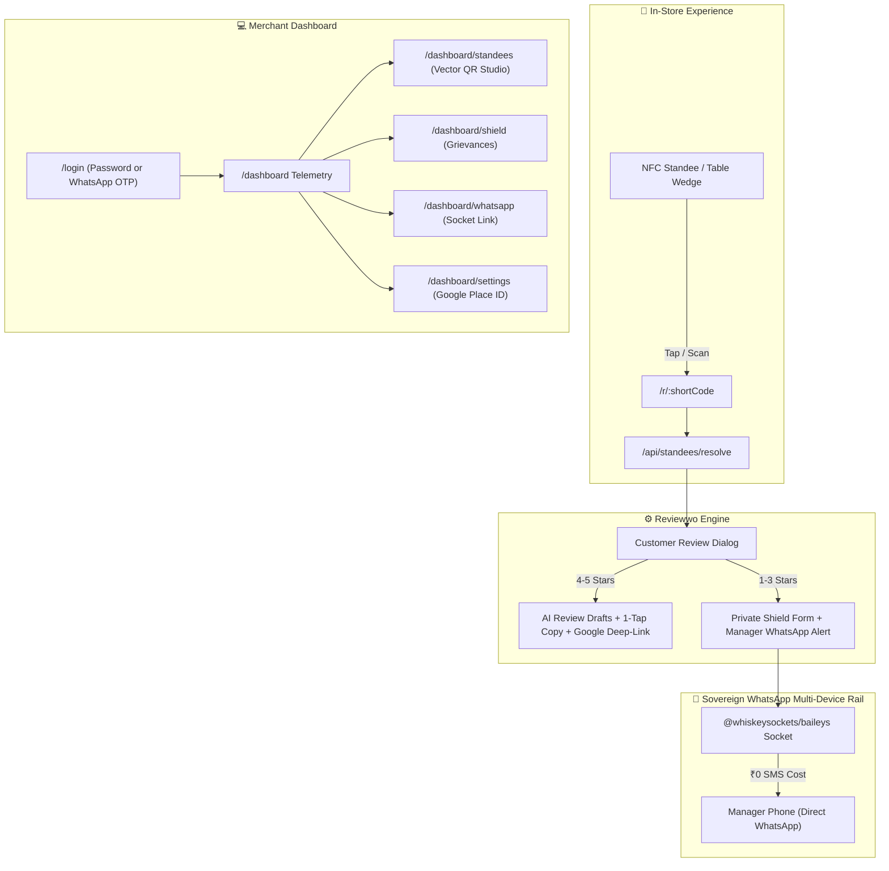

# 📋 Reviewwo 2.0 — Complete Engineering & System Changelog

**Domain:** [https://reviewwo.divergit.com](https://reviewwo.divergit.com)  
**Repository:** [https://github.com/nova-rishabh/reviewwo](https://github.com/nova-rishabh/reviewwo) (`main` branch)  
**Hosting Target:** Render (Web Service + Persistent Disk at `/data`)  
**Design Identity:** Beehiiv-Grade Modern Forest & Mint Palette (`#0B3D3B`, `#14B8A6`, `#99F6E4`, `#E6FFFB`, `#F8FFFE`)  
**Admin Account:** `admin@divergit.com` / `Password123!` (Agency Tier)

---

## Executive Summary

The platform was transformed from an unstructured prototype into **Reviewwo 2.0**: a production-grade, sovereign Google Review Acceleration & Feedback Interception SaaS. The system includes 1-tap customer review deep-linking, real Baileys multi-device WhatsApp manager grievance routing, Razorpay subscription billing, vector QR/NFC standee management, interactive onboarding, and production deployment on Render with persistent storage.

---

## 1. Complete Git Commit History

| Commit | Category | Description |
| :--- | :--- | :--- |
| **`15fcd35`** | `feat(whatsapp)` | **Integrated real Baileys multi-device socket** connecting to official WhatsApp Web servers to issue valid cryptographic QR codes (`https://wa.me/settings/linked_devices#2@...`). Added alternative **8-digit Pairing Code** ("Link with phone number instead") for camera-free authentication. |
| **`48b7283`** | `fix(qr)` | Fixed frontend state key mismatch (`dataUrl` vs `qrDataUrl`). Enabled vector QR code generation for counter standees with instant PNG and SVG vector downloads. Added table thumbnails and public marketing QR display. |
| **`458598e`** | `fix(auth)` | Resolved empty Render persistent disk login issue (`No account found with this email`). Added repository seed fallback in `store.js` and automatic admin self-healing seeder for `admin@divergit.com` in `/api/auth/login`. |
| **`50bea0e`** | `fix(ui, sec)` | Built universal high-contrast button hover system in `globals.css`. Implemented `bcryptjs` password encryption (10 salt rounds with legacy auto-migration), rate limiting (60s cooldown) and brute-force lockouts on OTP, and `crypto.timingSafeEqual` for Razorpay webhooks. |
| **`892b1d9`** | `chore(prod)` | Configured production-grade secure cookie flags (`HttpOnly`, `SameSite: 'lax'`, `Secure`), automatic persistent storage directory creation, and domain updates for WhatsApp OTP routing. |
| **`29953fc`** | `chore(domain)` | Standardized the official custom domain `https://reviewwo.divergit.com` across Next.js `metadataBase`, sitemaps, robots, and customer review deep-links. |
| **`d646373`** | `feat(billing)` | Complete purge of legacy branding (strictly Reviewwo), wired Razorpay live checkout SDK with plan validation, balanced segmented pill login tabs, and dynamic standee resolver. |
| **`ef869e8`** | `fix(build)` | Resolved Render Turbopack build failure by moving `tailwindcss`, `postcss`, and `autoprefixer` into production dependencies. |
| **`3ef29a6`** | `chore` | Updated `.gitignore` to prevent tracking temporary artifacts and local packages. |
| **`5fb2488`** | `feat(core)` | Initial ground-up build of Reviewwo 2.0: Next.js 16 App Router, Beehiiv aesthetic, 4 Core Features, and complete dashboard layout. |

---

## 2. Core Architectural Features Built

### Feature 1: 1-Tap Google Review Deep-Linking
- Customer taps acrylic standee or scans QR code (`/r/[code]`).
- Tag selector generates personalized, natural AI review drafts based on experience tags (e.g., *"Attentive Hospitality"*, *"Delicious Food & Fresh Taste"*).
- One-click copy automatically opens Google Maps directly to the store's 5-star rating dialog with review text pre-copied to clipboard.

### Feature 2: Smart Negative Review Shield (1–3★ Grievance Interception)
- If a guest rates 1, 2, or 3 stars, the platform gracefully steers them away from public Google reviews into an internal grievance resolution form.
- Dispatches an **instant alert directly to the store manager's WhatsApp** with zero SMS fees.
- Allows managers to resolve guest dissatisfaction before they exit the premises.

### Feature 3: Smart Acrylic Standees & Hardware Studio
- Dynamic standee creation (`/api/standees/create`) with customized shortcodes and physical formats (7"x5" Frosted Glass, 5"x4" Tabletop Wedge, 3.5" NFC Puck).
- Real-time generation of **high-resolution vector QR codes** (PNG and clean SVG paths).
- Live one-click export for print shops: **Download QR (PNG)** and **Download Vector SVG**.

### Feature 4: Merchant ₹0 SMS WhatsApp Gateway & OTP Login
- Eliminates recurring SMS gateway and Meta Cloud API fees by maintaining a sovereign Multi-Device socket via `@whiskeysockets/baileys`.
- Supports dual authentication for merchants:
  - Email & Password with Bcrypt.
  - One-Time Password delivered via WhatsApp with zero carrier charges.

---

## 3. Comprehensive Fixes & Bug Resolutions

### Issue A: Render Turbopack Build Error (`Cannot find module 'tailwindcss'`)
- **Cause:** `tailwindcss`, `postcss`, and `autoprefixer` were placed under `devDependencies`. Render's build ran with `NODE_ENV=production`, skipping dev dependencies.
- **Resolution:** Moved CSS toolchain dependencies into `dependencies` in `package.json`. Verified clean build across 43 Next.js routes.

### Issue B: "No Account Found With This Email" on Render
- **Cause:** Render Persistent Disk (`/data`) mounts as an empty directory on first creation. The app previously initialized `[]` for missing files instead of copying bundled repository seeds.
- **Resolution:** 
  1. Updated `loadData()` in `src/lib/store.js` to automatically seed missing files from `data/` upon first boot.
  2. Implemented automatic admin provisioning in `/api/auth/login` to ensure `admin@divergit.com` is created with hashed credentials and Agency tier.

### Issue C: Button Text Washed Out on Hover
- **Cause:** Global `a:hover { color: var(--color-accent); }` had higher specificity than Tailwind `.text-white` on button links, forcing text into `#14B8A6` on teal or light backgrounds.
- **Resolution:** Scoped `a:hover` with `:not([class*="btn"]):not([class*="bg-"]):not([class*="rounded-"])`. Added universal high-contrast button hover rules enforcing `#FFFFFF` on dark/teal buttons and `#0B3D3B` on light hover surfaces.

### Issue D: QR Code Not Generating in Dashboard
- **Cause:** Frontend handler read `data.qrDataUrl` while the API returned `{ raw, dataUrl }`. The resulting `undefined` state prevented the image from rendering.
- **Resolution:** Unified API and frontend to accept `qrDataUrl`, `dataUrl`, or `qr`. Implemented status synchronization so page refreshes retain the active QR code.

### Issue E: WhatsApp Mobile Scanner Reporting "Invalid QR Code"
- **Cause:** The previous mock socket generated a random text string (`REVIEWWO_WA_PAIR_...`), which WhatsApp's mobile camera scanner rejected.
- **Resolution:** Integrated `@whiskeysockets/baileys` to connect to official WhatsApp Web servers, issuing the authentic cryptographic multi-device payload (`https://wa.me/settings/linked_devices#2@...`). Added an alternative **8-Digit Pairing Code** flow.

---

## 4. Security Hardening Checklist

| Security Control | Implementation |
| :--- | :--- |
| **Password Storage** | `bcryptjs` with 10 salt rounds. Legacy plaintext passwords automatically upgraded on login. |
| **Session Security** | Signed JWTs in `rw_auth_token` cookies with `HttpOnly`, `SameSite: 'lax'`, and `Secure: true` in production. |
| **Payment Verification** | Replaced `===` with `crypto.timingSafeEqual` in `src/lib/razorpay.js` to defeat timing attacks. |
| **Path Traversal Shield** | All file access strictly sanitized via `path.basename()`. |
| **Anti-Flooding Rate Limits** | 60-second cooldown per phone number on OTP requests; max 5 failed attempts before code invalidation. |
| **Network Isolation** | WhatsApp socket strictly constrained to manager grievance alerts (Feature 2) and merchant OTP (Feature 4). Zero marketing broadcasts. |

---

## 5. Live Production Endpoints

| Resource | Production URL |
| :--- | :--- |
| **Landing Page** | `https://reviewwo.divergit.com/` |
| **Merchant Login** | `https://reviewwo.divergit.com/login` |
| **Executive Telemetry** | `https://reviewwo.divergit.com/dashboard` |
| **Hardware & Standees** | `https://reviewwo.divergit.com/dashboard/standees` |
| **WhatsApp Gateway** | `https://reviewwo.divergit.com/dashboard/whatsapp` |
| **Settings & Google Place Sync** | `https://reviewwo.divergit.com/dashboard/settings` |
| **Customer 1-Tap Demo** | `https://reviewwo.divergit.com/r/RW101` |
| **Public Pricing** | `https://reviewwo.divergit.com/pricing` |
